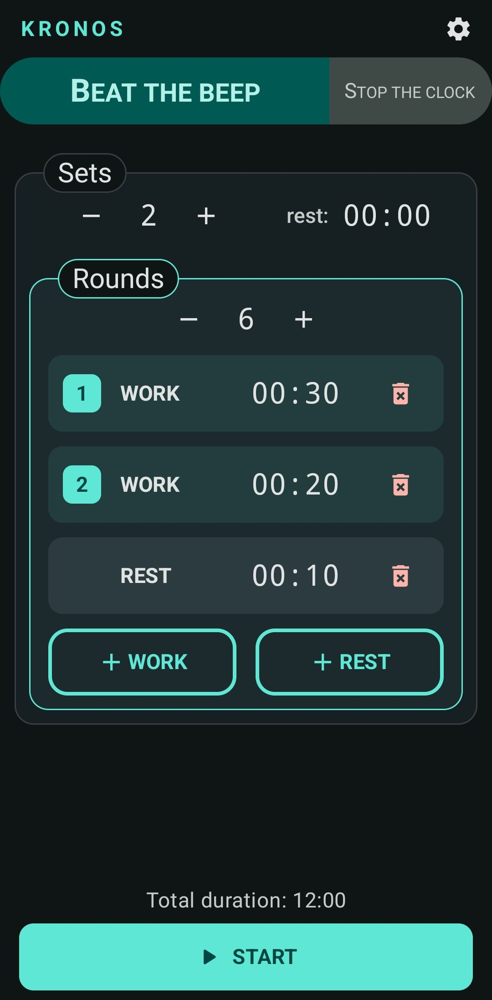
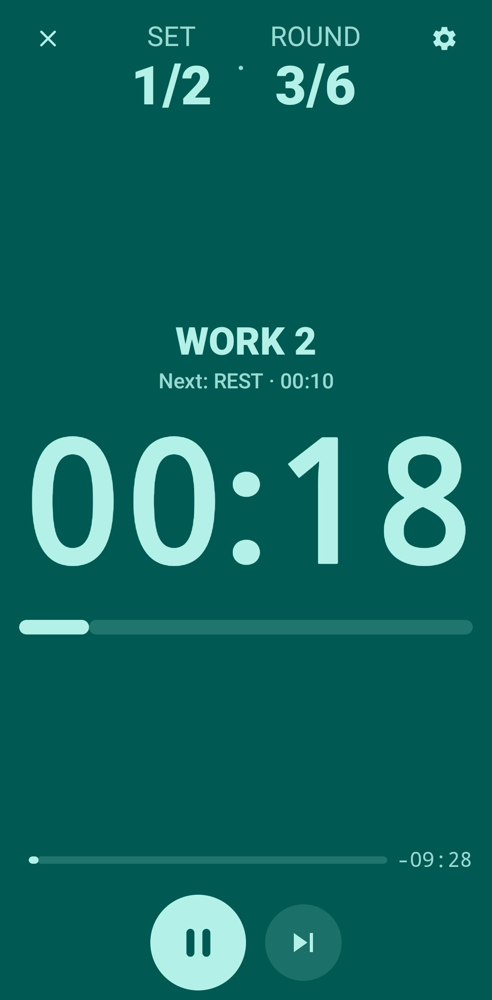
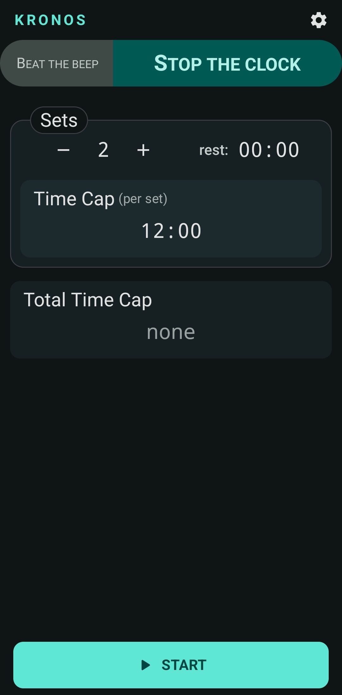

# Kronos

Kronos is an Android workout timer application supporting customizable interval training and count-up timing with background service execution and audio cues.


---

## Screenshots
### Timer mode
|                         Setup                          |                         Running                          |
|:------------------------------------------------------:|:--------------------------------------------------------:|
|  |  |

### For time mode
|                           Setup                           |                           Running                           |                             Finish                              |
|:---------------------------------------------------------:|:-----------------------------------------------------------:|:---------------------------------------------------------------:|
|  |  |  |

---

## Features

- **Training Modes**:
  - **Timer**: Countdown timer for interval workouts with configurable sets, rounds, work tasks, rest tasks, and rest between sets.
  - **For Time**: Count-up timer with round/lap tracking and optional per-set and total time caps.
- **Workout Configuration**: Setup screen for configuring sets, rounds, work/rest task sequences, and rest durations with estimated total workout duration.
- **Config Persistence**: Saves the last used workout setup locally using Jetpack DataStore.
- **Settings**: Icon-only toggles for beeps and voice (also reachable from the running screen) and a System / Light / Dark theme, saved with DataStore.
- **Background Execution**: Runs as an Android Foreground Service (`TimerService`) with persistent notifications, notification controls (pause, resume, stop, and lap in For Time mode), and a partial wake lock to keep timing active when the screen is locked or the app is in the background.
- **Audio Cues**: Voice announcements from pre-recorded clips (`assets/audio/*.ogg`, played through an `Announcer`) for workout phases, and synthesized PCM audio tones (beeps, buzzers, completion sound) using `AudioTrack`.
- **Custom UI Components**: Built with Jetpack Compose (Material 3), including numeric inputs (`TimeInput`), a docked keypad (`DockedKeypad`/`KeypadState`: tap a field, type, tap the next field; the previous entry is committed automatically), and stepper controls (`HybridStepper`).

---

## Tech Stack

- **Language**: Kotlin
- **UI Framework**: Jetpack Compose with Material 3 and Edge-to-Edge display
- **Architecture**: MVVM with Repository pattern and pure Kotlin timing state machine (`TimerEngine`)
- **State Management**: Kotlin Coroutines and `StateFlow`
- **Data Persistence**: Jetpack DataStore (Preferences) with Kotlinx Serialization
- **Background Execution**: Android Foreground Service with system notification integration
- **Audio**: recorded voice clips decoded to PCM (`MediaCodec`) and played through `AudioTrack` (behind the `Announcer` interface); beeps synthesized by `ToneSynth` and played as static `AudioTrack`s

---

## Project Structure

```
app/src/main/java/com/baccours/kronos/
├── engine/       # TimerEngine (clock + state machine) and WorkoutController (tick scheduling, cues, state reporting; no Android dependencies, tested with virtual time)
├── model/        # Data models (TimerConfig incl. limits and `sanitized()`, Task, TimerState, Lap, etc.) and TimerConfigCodec (JSON)
├── AppContainer  # the shared WorkoutStateStore / SettingsRepository / TimerConfigRepository, created by KronosApp (composition root)
├── repository/   # WorkoutStateStore (live workout state) & the DataStore repositories (SettingsRepository also holds the live settings and saves every change)
├── audio/        # TimerAudioManager (routes cues to the tones or the Announcer); Announcer, ClipAnnouncer, ClipLibrary, ClipCatalog, ClipDecoder (voice clips); ToneSynth, StaticTrack (beeps); PcmUtil; AudioFocusController
├── service/      # TimerService (thin Foreground Service shell), WorkoutSession (its logic: no Android imports, tested with virtual time), TimerNotifier, WorkoutCommands (UI -> service), HandlerTickScheduler
├── format/       # Display helpers shared by the UI and the notification (formatDuration, phaseLabel, caps)
└── ui/           # Setup, Running and Settings screens with their view models, components (Keypad, TimeInput), Theme
```

**Validation**: `TimerConfig.sanitized()` is the single clamping point. It runs when the setup view model applies an edit and when the codec decodes stored or transmitted text; the engine assumes a valid config.

---

### Dependencies

Arrows read "depends on"; the graph has no cycles and must stay that way (enforced by `LayeringTest`).

```
KronosApp, MainActivity  ->  ui, service, repository, audio (composition root)
ui        ->  repository, format, model      (never service/audio/engine)
service   ->  engine, audio, repository, format, model
audio     ->  engine (Cue, Speech, CuePlayer), model
engine    ->  model
repository, format  ->  model
model     ->  nothing
```

`engine` and `model` have no Android imports. `ui.components` and `ui.icons` are generic (no `model`).

## Required Permissions

- `POST_NOTIFICATIONS`: Display persistent notification controls on Android 13+ (API 33+).
- `FOREGROUND_SERVICE` and `FOREGROUND_SERVICE_SPECIAL_USE`: Keep the workout service active in the background (Android 14+ needs the service type; Google Play asks for a declaration of the special-use case).
- `WAKE_LOCK`: Keep the CPU awake while a workout is running with the screen off.

The notification permission is requested the first time a workout is started. Declining it only hides the notification; the workout still runs.

---

## Voice Clips

Spoken cues are generated as `Speech` values by the engine and announced via `ClipAnnouncer` using pre-recorded `.ogg` files in `app/src/main/assets/audio/` (defined in `ClipCatalog`).

- **Pre-decoding & Caching**: Clips are decoded to PCM ahead of time—common phrases at launch, the cues a workout needs when it starts—and cached in `ClipLibrary` to eliminate playback latency.
- **Audio Assets**: Trimmed mono `.ogg` files covering phrases (`get_ready`, `go`, `rest`, etc.), dedicated clips for 1–10 (e.g., `work01`), and composite label + number words for higher values (up to 999). Generated with `ffmpeg`:
  ```bash
  ffmpeg -nostdin -i "input_file" -vn -ac 1 -ar 48000 \
      -af "silenceremove=start_periods=1:start_threshold=-50dB,areverse,silenceremove=start_periods=1:start_threshold=-50dB,areverse" \
      -c:a libvorbis -q:a 3 "output.ogg"
  ```
- **Extensibility & Fallbacks**: Implement `Announcer` to support alternative voice engines (e.g., TTS) or custom fallbacks. Missing clips degrade gracefully without interrupting audio tones.
